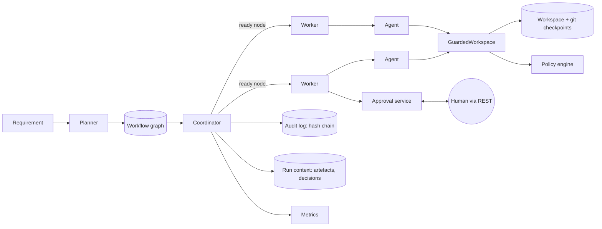
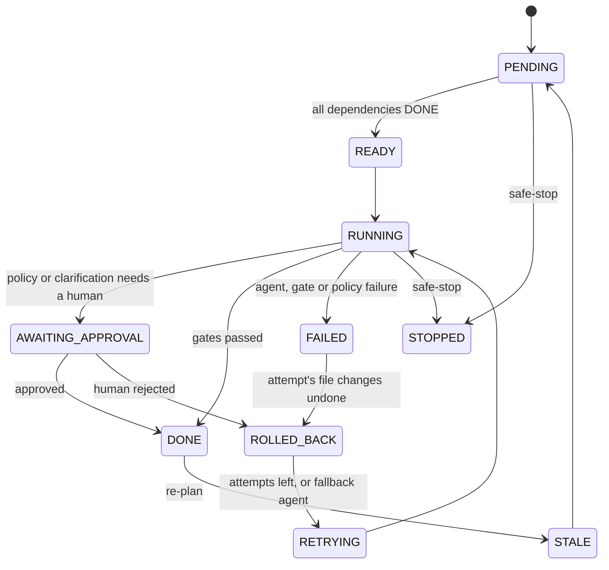

# Architecture

## 1. Big picture

Everything that changes the shape of a run - accepting a result, expanding the plan, re-planning, stopping - happens on the **coordinator thread**. Everything that can block or fail - running an agent, waiting for a human, retrying - happens on a **worker** (a virtual thread, one per ready node).

## 2. Node lifecycle

Transitions are validated by `NodeState.canMoveTo` and executed only by `NodeStateMachine`, which writes each one to the audit log. An illegal transition is a bug and throws.

## 3. What happens when something goes wrong

| Situation | Reaction | Recorded as |
|---|---|---|
| Exit gate fails (build, tests, missing output) | rollback attempt, retry with the failure as feedback, exponential backoff | `GATE` failed, `ROLLBACK`, `RETRY` |
| Policy denies a write outside the agent's boundary | same as above (non-fatal) | `POLICY` DENY |
| Retry budget exhausted, node has a fallback agent | switch to the fallback agent with its own budget | `FALLBACK` |
| Budget exhausted, no fallback | **safe-stop** | `SAFE_STOP` |
| Secret written, or path escapes the workspace | **safe-stop immediately**, no retry; the write never reaches disk | `POLICY` DENY (fatal), `SAFE_STOP` |
| Human rejects | rollback, rework with the reviewer's comment | `APPROVAL_DECIDED` REJECTED, `RETRY` |
| No human decision before the timeout | safe-stop | `SAFE_STOP` |
| Audit log cannot be written | stop (fail closed) | - |

**Safe-stop** cancels waiting approvals, interrupts workers, marks every unfinished node `STOPPED`, and restores the workspace to the last checkpoint. Completed, approved work is kept and visible in the report.

## 4. Governance

* **Autonomy boundaries** (`AutonomyBoundaries`): each agent has write globs and a file limit, e.g. `architect` may write `docs/**` and `openapi.yaml` only; `developer` may write `pom.xml` and `src/main/**`; unknown agents are read-only (deny by default).
* **Policy engine**: secret patterns on every write, dependency `groupId` allow-list on every `pom.xml` write, and *change control* after a node: HIGH-risk nodes and anything touching `openapi.yaml`, `db/migration/**` or `schema*.sql` require a human.
* **Humans own**: design, schema migration, release and final sign-off are HIGH risk. Approvals and clarifications use the same mechanism, are attributed to a named actor, and appear in the audit log and in decision lineage. The simulated reviewer used in demos is labelled `human:simulated-reviewer`.

## 5. Context, lineage and audit

* `RunContext` holds the requirement and amendments, assumptions, every produced file as a *versioned, SHA-256-hashed artefact*, and the decision records.
* Each accepted node writes a `DecisionRecord` (actor, decision, rationale, **input artefacts** and **output artefacts** with hashes); a human approval is a second record. `LineageService` walks outputs → decisions → inputs to answer "why does this file look like this?".
* `EventLog` is append-only; each event stores the hash of its predecessor. `EventLog.verify` detects edited, removed or reordered events. It is written to disk synchronously and fails closed.

## 6. Dynamic planning

* `Planner.plan` builds the initial graph per scenario; `Planner.expandAfter` runs after a node is accepted and may add nodes and edges. Examples: brownfield adds `migration` (HIGH) and makes `implement` depend on it when impact analysis finds a schema change; ambiguous adds one `plan-<id>` node per interpretation a human confirmed and makes `scoped-plan` wait for them.
* **Re-planning** is triggered by a requirement change (scripted or `POST /runs/{id}/replan`) or by a re-run producing a different artefact hash. The target and everything downstream become `STALE → PENDING`; nodes that are running are marked *invalidated* and their result is discarded when it arrives. Re-plans are capped (`maxReplans`).

## 7. Metrics

First-attempt success rate, retries, rollbacks, fallbacks, safe-stops, re-plans, approvals, MTTR (first failure → success of the same node) and end-to-end latency, per run, in `metrics.json`, `report.md`, the API, and as Micrometer counters/timers.

## 8. Extension points

* New agent: implement `Agent`, add it to `AgentRegistry` (`AppConfig`), give it a boundary in `AutonomyBoundaries`, use it in a `TaskNode`.
* New scenario: add a branch to `Planner.plan` (and optionally `expandAfter`).
* New gate: a `Gate(name, ctx -> GateResult)`; see `Gates`.
* Different build tool or sandbox: implement `BuildRunner`.
* Durable runs: replace the in-memory `RunManager` map with a store and re-hydrate from `events.jsonl` + the git history.
