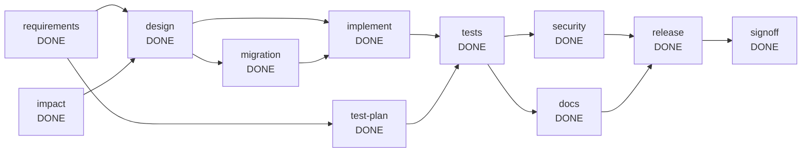

# Run report: brownfield

- Run id: `run-8b30c9a5`
- Scenario: **BROWNFIELD**
- Outcome: **COMPLETED**
- Requirement: Add optional link expiry and per-IP rate limiting to the existing URL shortener without breaking its current API.
- Audit chain: verified (157 events)

## Reliability metrics

| Metric | Value |
| --- | --- |
| Nodes completed | 11 / 11 |
| First-attempt success rate | 100% |
| Retries | 0 |
| Rollbacks | 0 |
| Fallbacks | 0 |
| Safe-stops | 0 |
| Re-plans | 1 |
| Human approvals | 6 |
| Mean time to recovery | 0 ms |
| End-to-end latency | 16677 ms |

## Dependency graph

## Nodes

| Node | Agent | Risk | State | Attempts | Depends on |
| --- | --- | --- | --- | --- | --- |
| requirements | requirements | LOW | DONE | 1 | [] |
| impact | architect | LOW | DONE | 1 | [] |
| design | architect | HIGH | DONE | 2 | [requirements, impact] |
| test-plan | test | LOW | DONE | 1 | [requirements] |
| implement | developer | MEDIUM | DONE | 2 | [design, migration] |
| tests | test | MEDIUM | DONE | 1 | [implement, test-plan] |
| security | security | MEDIUM | DONE | 1 | [tests] |
| docs | docs | LOW | DONE | 1 | [tests] |
| release | release | HIGH | DONE | 1 | [security, docs] |
| signoff | reviewer | HIGH | DONE | 1 | [release] |
| migration | golden-developer | HIGH | DONE | 2 | [design] |

## Timeline (state changes omitted)

| # | Type | Node | Actor | Detail |
| --- | --- | --- | --- | --- |
| 1 | RUN_STARTED | run | orchestrator | BROWNFIELD \| Add optional link expiry and per-IP rate limiting to the existing URL shortener without breaking its current API. |
| 2 | PLAN_CREATED | run | orchestrator | requirements; impact; design<-[requirements, impact]; test-plan<-[requirements]; implement<-[design]; tests<-[implement, test-plan]; security<-[tests]; docs<-[tests]; release<-[sec... |
| 3 | CHECKPOINT | run | orchestrator | run-start -> 595f5b6401a461c46f1d74f9fea9b7135b5369bf |
| 7 | GATE | requirements | orchestrator | entry gate 'none': passed |
| 9 | GATE | impact | orchestrator | entry gate 'none': passed |
| 10 | AGENT | requirements | requirements | attempt 1: normalised requirement into 3 functional requirements and 3 acceptance criteria |
| 11 | GATE | requirements | orchestrator | exit gate 'outputs-exist:docs/requirements.md': passed |
| 13 | DECISION | requirements | requirements | D-1 completed: kept scope to what the requirement states; recorded 6 assumptions explicitly instead of guessing silently |
| 14 | CHECKPOINT | run | orchestrator | after requirements -> 8464e70b0a9bb4b03f0057a82b9ac19b657226a9 |
| 17 | GATE | test-plan | orchestrator | entry gate 'none': passed |
| 18 | AGENT | test-plan | test | attempt 1: test plan with 10 risk-based cases |
| 19 | GATE | test-plan | orchestrator | exit gate 'outputs-exist:docs/test-plan.md': passed |
| 21 | DECISION | test-plan | test | D-2 completed: tests are planned from the requirement in parallel with the design, so they are not biased by the implementation |
| 22 | CHECKPOINT | run | orchestrator | after test-plan -> d8e29ece20f2b40719dddb9218755483d4383413 |
| 23 | AGENT | impact | architect | attempt 1: parsed 17 classes, 5 endpoints; 5 impacted components; schema change: true |
| 24 | GATE | impact | orchestrator | exit gate 'outputs-exist:docs/impact-analysis.md': passed |
| 26 | DECISION | impact | architect | D-3 completed: impact derived from the parsed code structure and the concerns found in the requirement |
| 27 | CHECKPOINT | run | orchestrator | after impact -> 679270abca210bd1c45f76aa425624d04563165c |
| 28 | PLAN_EXPANDED | impact | orchestrator | plan expanded after 'impact': added [migration] \| requirements; impact; design<-[requirements, impact]; test-plan<-[requirements]; implement<-[design, migration]; tests<-[implement... |
| 31 | GATE | design | orchestrator | entry gate 'inputs-available:docs/requirements.md': passed |
| 32 | AGENT | design | architect | attempt 1: produced design.md and openapi.yaml (with expiry, with rate limiting, 0 amendments) |
| 33 | GATE | design | orchestrator | exit gate 'outputs-exist:docs/design.md,openapi.yaml': passed |
| 34 | POLICY | design | orchestrator | REQUIRE_APPROVAL [change-control] node 'design' is HIGH risk (Design the solution and the OpenAPI contract) |
| 36 | APPROVAL_REQUESTED | design | orchestrator | design: produced design.md and openapi.yaml (with expiry, with rate limiting, 0 amendments) (node 'design' is HIGH risk (Design the solution and the OpenAPI contract)) |
| 37 | APPROVAL_DECIDED | design | human:simulated-reviewer | approved reviewed and approved (simulated) |
| 39 | DECISION | design | architect | D-4 completed: contract-first: the OpenAPI file is the reviewed artefact that the implementation must follow |
| 40 | DECISION | design | human:simulated-reviewer | D-5 approved: reviewed and approved (simulated) |
| 41 | CHECKPOINT | run | orchestrator | after design -> 8cad3272209e2cd4cbac3578954ada05b47679ea |
| 44 | GATE | migration | orchestrator | entry gate 'none': passed |
| 45 | AGENT | migration | golden-developer | attempt 1: applied the verified 'migration' implementation (1 files) |
| 46 | GATE | migration | orchestrator | exit gate 'outputs-exist:src/main/resources/db/migration/V2__add_link_expiry.sql': passed |
| 47 | POLICY | migration | orchestrator | REQUIRE_APPROVAL [change-control] node 'migration' is HIGH risk (Database migration for the new column (added because impact analysis found a schema change)) |
| 49 | APPROVAL_REQUESTED | migration | orchestrator | migration: applied the verified 'migration' implementation (1 files) (node 'migration' is HIGH risk (Database migration for the new column (added because impact analysis found a sc... |
| 50 | APPROVAL_DECIDED | migration | human:simulated-reviewer | approved reviewed and approved (simulated) |
| 52 | DECISION | migration | golden-developer | D-6 completed: deterministic change set; the need for it was established by the impact analysis |
| 53 | DECISION | migration | human:simulated-reviewer | D-7 approved: reviewed and approved (simulated) |
| 54 | CHECKPOINT | run | orchestrator | after migration -> 0473ceb49785360aee3f6a9aab0587c7415f1901 |
| 57 | GATE | implement | orchestrator | entry gate 'inputs-available:docs/design.md,openapi.yaml': passed |
| 58 | AGENT | implement | developer | attempt 1: developer (brownfield): replayed the verified implementation (11 files); no language model configured |
| 59 | GATE | implement | orchestrator | exit gate 'build-passes': passed |
| 61 | DECISION | implement | developer | D-8 completed: implemented from the approved design and contract |
| 62 | CHECKPOINT | run | orchestrator | after implement -> 646c6d2ef824b809fdd79d0b80343017679cc66e |
| 63 | REPLAN | design | requester | requirement change: Clients must know when to retry: document the Retry-After header on 429 responses in the API contract. |
| 66 | REPLAN | design | orchestrator | marked stale and re-queued: requirement change: Clients must know when to retry: document the Retry-After header on 429 responses in the API contract. |
| 69 | REPLAN | implement | orchestrator | marked stale and re-queued: requirement change: Clients must know when to retry: document the Retry-After header on 429 responses in the API contract. |
| 72 | REPLAN | migration | orchestrator | marked stale and re-queued: requirement change: Clients must know when to retry: document the Retry-After header on 429 responses in the API contract. |
| 75 | GATE | design | orchestrator | entry gate 'inputs-available:docs/requirements.md': passed |
| 76 | AGENT | design | architect | attempt 2: produced design.md and openapi.yaml (with expiry, with rate limiting, 1 amendments) |
| 77 | GATE | design | orchestrator | exit gate 'outputs-exist:docs/design.md,openapi.yaml': passed |
| 78 | POLICY | design | orchestrator | REQUIRE_APPROVAL [change-control] node 'design' is HIGH risk (Design the solution and the OpenAPI contract) |
| 80 | APPROVAL_REQUESTED | design | orchestrator | design: produced design.md and openapi.yaml (with expiry, with rate limiting, 1 amendments) (node 'design' is HIGH risk (Design the solution and the OpenAPI contract)) |
| 81 | APPROVAL_DECIDED | design | human:simulated-reviewer | approved reviewed and approved (simulated) |
| 83 | DECISION | design | architect | D-10 completed: contract-first: the OpenAPI file is the reviewed artefact that the implementation must follow |
| 84 | DECISION | design | human:simulated-reviewer | D-11 approved: reviewed and approved (simulated) |
| 85 | CHECKPOINT | run | orchestrator | after design -> 39ab4304af3a0cb7c391907b8127fb20499229ff |
| 88 | GATE | migration | orchestrator | entry gate 'none': passed |
| 89 | AGENT | migration | golden-developer | attempt 2: applied the verified 'migration' implementation (1 files) |
| 90 | GATE | migration | orchestrator | exit gate 'outputs-exist:src/main/resources/db/migration/V2__add_link_expiry.sql': passed |
| 91 | POLICY | migration | orchestrator | REQUIRE_APPROVAL [change-control] node 'migration' is HIGH risk (Database migration for the new column (added because impact analysis found a schema change)) |
| 93 | APPROVAL_REQUESTED | migration | orchestrator | migration: applied the verified 'migration' implementation (1 files) (node 'migration' is HIGH risk (Database migration for the new column (added because impact analysis found a sc... |
| 94 | APPROVAL_DECIDED | migration | human:simulated-reviewer | approved reviewed and approved (simulated) |
| 96 | DECISION | migration | golden-developer | D-12 completed: deterministic change set; the need for it was established by the impact analysis |
| 97 | DECISION | migration | human:simulated-reviewer | D-13 approved: reviewed and approved (simulated) |
| 98 | CHECKPOINT | run | orchestrator | after migration -> c636fe430657ba13821ee67d3dc59cca048fc4fe |
| 101 | GATE | implement | orchestrator | entry gate 'inputs-available:docs/design.md,openapi.yaml': passed |
| 102 | AGENT | implement | developer | attempt 2: developer (brownfield): replayed the verified implementation (11 files); no language model configured |
| 103 | GATE | implement | orchestrator | exit gate 'build-passes': passed |
| 105 | DECISION | implement | developer | D-14 completed: retry with feedback from the previous failure |
| 106 | CHECKPOINT | run | orchestrator | after implement -> fdcf3ddee5fe2f9394d92b126a3888561da45cc4 |
| 109 | GATE | tests | orchestrator | entry gate 'none': passed |
| 110 | AGENT | tests | test | attempt 1: tests passed (31 tests, 0 failures, 0 errors); replayed 6 verified test files; no language model configured |
| 111 | GATE | tests | orchestrator | exit gate 'tests-pass': passed |
| 113 | DECISION | tests | test | D-15 completed: the result is recorded in the run context; the exit gate, not the agent, decides acceptance |
| 114 | CHECKPOINT | run | orchestrator | after tests -> 3fc1727661ace72a1292be0016fc12613460273a |
| 118 | GATE | docs | orchestrator | entry gate 'none': passed |
| 120 | GATE | security | orchestrator | entry gate 'none': passed |
| 121 | AGENT | security | security | attempt 1: security review PASS (0 non-blocking findings, 29 files scanned) |
| 122 | GATE | security | orchestrator | exit gate 'outputs-exist:docs/security-review.md': passed |
| 124 | DECISION | security | security | D-16 completed: blocking findings fail the node; the agent cannot waive them |
| 125 | AGENT | docs | docs | attempt 1: README and changelog generated from 5 parsed endpoints |
| 126 | GATE | docs | orchestrator | exit gate 'outputs-exist:README.md,docs/CHANGELOG.md': passed |
| 127 | CHECKPOINT | run | orchestrator | after security -> 984ae7e3e5927a3e09ece0624ca62643c59330e3 |
| 129 | DECISION | docs | docs | D-17 completed: documentation is derived from the code so it cannot drift from the implementation |
| 130 | CHECKPOINT | run | orchestrator | after docs -> 83d10395c6166db42ba74a4fc9424de688703f23 |
| 133 | GATE | release | orchestrator | entry gate 'none': passed |
| 134 | AGENT | release | release | attempt 1: release readiness checklist passed (5 checks) |
| 135 | GATE | release | orchestrator | exit gate 'outputs-exist:docs/release-notes.md': passed |
| 136 | POLICY | release | orchestrator | REQUIRE_APPROVAL [change-control] node 'release' is HIGH risk (Release readiness check and release notes) |
| 138 | APPROVAL_REQUESTED | release | orchestrator | release: release readiness checklist passed (5 checks) (node 'release' is HIGH risk (Release readiness check and release notes)) |
| 139 | APPROVAL_DECIDED | release | human:simulated-reviewer | approved reviewed and approved (simulated) |
| 141 | DECISION | release | release | D-18 completed: release is blocked unless every check passes; the human approves afterwards |
| 142 | DECISION | release | human:simulated-reviewer | D-19 approved: reviewed and approved (simulated) |
| 143 | CHECKPOINT | run | orchestrator | after release -> 89afed6c68b572ba52f7f281ebcd0ef6950226eb |
| 146 | GATE | signoff | orchestrator | entry gate 'none': passed |
| 147 | AGENT | signoff | reviewer | attempt 1: engineering summary written for human sign-off |
| 148 | GATE | signoff | orchestrator | exit gate 'decisions-recorded': passed |
| 149 | POLICY | signoff | orchestrator | REQUIRE_APPROVAL [change-control] node 'signoff' is HIGH risk (Engineering summary and final human sign-off) |
| 151 | APPROVAL_REQUESTED | signoff | orchestrator | signoff: engineering summary written for human sign-off (node 'signoff' is HIGH risk (Engineering summary and final human sign-off)) |
| 152 | APPROVAL_DECIDED | signoff | human:simulated-reviewer | approved reviewed and approved (simulated) |
| 154 | DECISION | signoff | reviewer | D-20 completed: the reviewer only summarises recorded facts; it does not approve its own work |
| 155 | DECISION | signoff | human:simulated-reviewer | D-21 approved: reviewed and approved (simulated) |
| 156 | CHECKPOINT | run | orchestrator | after signoff -> 65d0176294f38da4b473bea4e931e66105f2d73f |
| 157 | RUN_FINISHED | run | orchestrator | COMPLETED nodes 11/11, retries 0, rollbacks 0, fallbacks 0, safe-stops 0, replans 1, approvals 6, 16677 ms |

## Decisions

| Id | Node | Actor | Decision | Rationale |
| --- | --- | --- | --- | --- |
| D-1 | requirements | requirements | completed | kept scope to what the requirement states; recorded 6 assumptions explicitly instead of guessing silently |
| D-2 | test-plan | test | completed | tests are planned from the requirement in parallel with the design, so they are not biased by the implementation |
| D-3 | impact | architect | completed | impact derived from the parsed code structure and the concerns found in the requirement |
| D-4 | design | architect | completed | contract-first: the OpenAPI file is the reviewed artefact that the implementation must follow |
| D-5 | design | human:simulated-reviewer | approved | reviewed and approved (simulated) |
| D-6 | migration | golden-developer | completed | deterministic change set; the need for it was established by the impact analysis |
| D-7 | migration | human:simulated-reviewer | approved | reviewed and approved (simulated) |
| D-8 | implement | developer | completed | implemented from the approved design and contract |
| D-9 | design | requester | requirement-changed | Clients must know when to retry: document the Retry-After header on 429 responses in the API contract. |
| D-10 | design | architect | completed | contract-first: the OpenAPI file is the reviewed artefact that the implementation must follow |
| D-11 | design | human:simulated-reviewer | approved | reviewed and approved (simulated) |
| D-12 | migration | golden-developer | completed | deterministic change set; the need for it was established by the impact analysis |
| D-13 | migration | human:simulated-reviewer | approved | reviewed and approved (simulated) |
| D-14 | implement | developer | completed | retry with feedback from the previous failure |
| D-15 | tests | test | completed | the result is recorded in the run context; the exit gate, not the agent, decides acceptance |
| D-16 | security | security | completed | blocking findings fail the node; the agent cannot waive them |
| D-17 | docs | docs | completed | documentation is derived from the code so it cannot drift from the implementation |
| D-18 | release | release | completed | release is blocked unless every check passes; the human approves afterwards |
| D-19 | release | human:simulated-reviewer | approved | reviewed and approved (simulated) |
| D-20 | signoff | reviewer | completed | the reviewer only summarises recorded facts; it does not approve its own work |
| D-21 | signoff | human:simulated-reviewer | approved | reviewed and approved (simulated) |

## Artefacts

| Path | Version | Producer | SHA-256 |
| --- | --- | --- | --- |
| README.md | 1 | docs | d63961feabac |
| docs/CHANGELOG.md | 1 | docs | a353d522d35a |
| docs/design.md | 2 | design | 313b95483ada |
| docs/engineering-summary.md | 1 | signoff | db88f4b46eec |
| docs/impact-analysis.md | 1 | impact | 3201900e435e |
| docs/release-notes.md | 1 | release | d950ddeb838d |
| docs/requirements.md | 1 | requirements | 9bfee3ea06bb |
| docs/security-review.md | 1 | security | 45f5e6a5491d |
| docs/test-plan.md | 1 | test-plan | 594d95369843 |
| docs/test-report.md | 1 | tests | 99faa9f6e15a |
| openapi.yaml | 1 | design | f99a652d3916 |
| src/main/java/com/agentic/shortener/api/LinkController.java | 1 | implement | b8ce33f3af33 |
| src/main/java/com/agentic/shortener/dto/LinkDtos.java | 1 | implement | 2b85faa9407b |
| src/main/java/com/agentic/shortener/error/GlobalExceptionHandler.java | 1 | implement | ddc955c89ebe |
| src/main/java/com/agentic/shortener/error/InvalidExpiryException.java | 1 | implement | fffbb7e3ee9d |
| src/main/java/com/agentic/shortener/error/LinkExpiredException.java | 1 | implement | 9774aa69311a |
| src/main/java/com/agentic/shortener/model/Link.java | 1 | implement | de6d06fad7ff |
| src/main/java/com/agentic/shortener/ratelimit/RateLimitFilter.java | 1 | implement | 37113342d73c |
| src/main/java/com/agentic/shortener/ratelimit/TokenBucket.java | 1 | implement | 980ab19916c7 |
| src/main/java/com/agentic/shortener/repository/LinkRepository.java | 1 | implement | 265a3d128fc1 |
| src/main/java/com/agentic/shortener/service/LinkService.java | 1 | implement | 3e2d92191068 |
| src/main/resources/application.properties | 1 | implement | 9836f7ffc3c1 |
| src/main/resources/db/migration/V2__add_link_expiry.sql | 1 | migration | dfe2cc50403f |
| src/test/java/com/agentic/shortener/api/LinkApiTest.java | 1 | tests | 1c6889128a73 |
| src/test/java/com/agentic/shortener/api/LinkExpiryApiTest.java | 1 | tests | 1c389f70eff8 |
| src/test/java/com/agentic/shortener/api/RateLimitApiTest.java | 1 | tests | c2a56344dc98 |
| src/test/java/com/agentic/shortener/ratelimit/TokenBucketTest.java | 1 | tests | 605ba14e38af |
| src/test/java/com/agentic/shortener/service/CodeGeneratorTest.java | 1 | tests | e73a4bd617be |
| src/test/java/com/agentic/shortener/validation/UrlValidatorTest.java | 1 | tests | 283c1580a903 |
