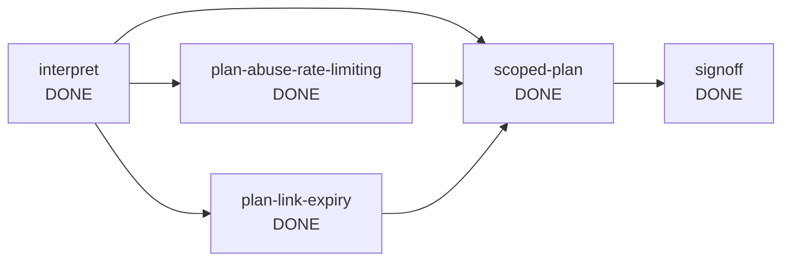

# Run report: ambiguous

- Run id: `run-e257a8bb`
- Scenario: **AMBIGUOUS**
- Outcome: **COMPLETED**
- Requirement: Make links safer.
- Audit chain: verified (55 events)

## Reliability metrics

| Metric | Value |
| --- | --- |
| Nodes completed | 5 / 5 |
| First-attempt success rate | 100% |
| Retries | 0 |
| Rollbacks | 0 |
| Fallbacks | 0 |
| Safe-stops | 0 |
| Re-plans | 0 |
| Human approvals | 2 |
| Mean time to recovery | 0 ms |
| End-to-end latency | 147 ms |

## Dependency graph

## Nodes

| Node | Agent | Risk | State | Attempts | Depends on |
| --- | --- | --- | --- | --- | --- |
| interpret | requirements | LOW | DONE | 1 | [] |
| scoped-plan | scope-planner | MEDIUM | DONE | 1 | [interpret, plan-abuse-rate-limiting, plan-link-expiry] |
| signoff | reviewer | HIGH | DONE | 1 | [scoped-plan] |
| plan-abuse-rate-limiting | scope-planner | LOW | DONE | 1 | [interpret] |
| plan-link-expiry | scope-planner | LOW | DONE | 1 | [interpret] |

## Timeline (state changes omitted)

| # | Type | Node | Actor | Detail |
| --- | --- | --- | --- | --- |
| 1 | RUN_STARTED | run | orchestrator | AMBIGUOUS \| Make links safer. |
| 2 | PLAN_CREATED | run | orchestrator | interpret; scoped-plan<-[interpret]; signoff<-[scoped-plan] |
| 3 | CHECKPOINT | run | orchestrator | run-start -> 005be2f58633ec0292bb3fc34ceb1f91640539d2 |
| 6 | GATE | interpret | orchestrator | entry gate 'none': passed |
| 7 | AGENT | interpret | requirements | attempt 1: identified 4 candidate interpretations; waiting for a human decision |
| 8 | GATE | interpret | orchestrator | exit gate 'outputs-exist:docs/interpretations.md': passed |
| 10 | APPROVAL_REQUESTED | interpret | orchestrator | Which interpretations of the requirement are in scope? See docs/interpretations.md |
| 11 | APPROVAL_DECIDED | interpret | human:simulated-reviewer | answered {abuse-rate-limiting=true, link-expiry=true, malware-blocking=false, access-control=false} scripted clarification answers |
| 13 | DECISION | interpret | requirements | D-1 completed: refused to guess the scope of an ambiguous requirement; asked the human instead |
| 14 | DECISION | interpret | human:simulated-reviewer | D-2 approved: scripted clarification answers |
| 15 | DECISION | interpret | human:simulated-reviewer | D-3 scope-confirmed: confirmed interpretations: [abuse-rate-limiting, link-expiry] |
| 16 | CHECKPOINT | run | orchestrator | after interpret -> 6304604520d9dee92da0c7357208ce184b9ede05 |
| 17 | PLAN_EXPANDED | interpret | orchestrator | plan expanded after 'interpret': added [plan-abuse-rate-limiting, plan-link-expiry] \| interpret; scoped-plan<-[interpret, plan-abuse-rate-limiting, plan-link-expiry]; signoff<-[sco... |
| 20 | GATE | plan-abuse-rate-limiting | orchestrator | entry gate 'none': passed |
| 21 | AGENT | plan-abuse-rate-limiting | scope-planner | attempt 1: planned 'Limit abuse per client' with 3 tasks |
| 22 | GATE | plan-abuse-rate-limiting | orchestrator | exit gate 'outputs-exist:docs/plan-abuse-rate-limiting.md': passed |
| 25 | DECISION | plan-abuse-rate-limiting | scope-planner | D-4 completed: planned only because a human confirmed this interpretation |
| 27 | GATE | plan-link-expiry | orchestrator | entry gate 'none': passed |
| 28 | AGENT | plan-link-expiry | scope-planner | attempt 1: planned 'Expire links automatically' with 3 tasks |
| 29 | GATE | plan-link-expiry | orchestrator | exit gate 'outputs-exist:docs/plan-link-expiry.md': passed |
| 30 | CHECKPOINT | run | orchestrator | after plan-abuse-rate-limiting -> 26af79aa24e1a3d4edb4c97a86d6f8124bc91b5a |
| 32 | DECISION | plan-link-expiry | scope-planner | D-5 completed: planned only because a human confirmed this interpretation |
| 33 | CHECKPOINT | run | orchestrator | after plan-link-expiry -> 642dadbe9e34f44a0c083d8bf94b300baa5f15fa |
| 36 | GATE | scoped-plan | orchestrator | entry gate 'none': passed |
| 37 | AGENT | scoped-plan | scope-planner | attempt 1: scoped plan: 2 in scope, 2 excluded |
| 38 | GATE | scoped-plan | orchestrator | exit gate 'outputs-exist:docs/scoped-plan.md': passed |
| 40 | DECISION | scoped-plan | scope-planner | D-6 completed: the human-confirmed scope bounds the plan; excluded items are listed explicitly |
| 41 | CHECKPOINT | run | orchestrator | after scoped-plan -> 89136c8b37b772a1e7ecc993210b2fe4cfa88297 |
| 44 | GATE | signoff | orchestrator | entry gate 'none': passed |
| 45 | AGENT | signoff | reviewer | attempt 1: engineering summary written for human sign-off |
| 46 | GATE | signoff | orchestrator | exit gate 'decisions-recorded': passed |
| 47 | POLICY | signoff | orchestrator | REQUIRE_APPROVAL [change-control] node 'signoff' is HIGH risk (Human sign-off of the scoped plan) |
| 49 | APPROVAL_REQUESTED | signoff | orchestrator | signoff: engineering summary written for human sign-off (node 'signoff' is HIGH risk (Human sign-off of the scoped plan)) |
| 50 | APPROVAL_DECIDED | signoff | human:simulated-reviewer | approved reviewed and approved (simulated) |
| 52 | DECISION | signoff | reviewer | D-7 completed: the reviewer only summarises recorded facts; it does not approve its own work |
| 53 | DECISION | signoff | human:simulated-reviewer | D-8 approved: reviewed and approved (simulated) |
| 54 | CHECKPOINT | run | orchestrator | after signoff -> 67a3b6d27e8f6c9344b9cf098f9af1e5fc0b35c6 |
| 55 | RUN_FINISHED | run | orchestrator | COMPLETED nodes 5/5, retries 0, rollbacks 0, fallbacks 0, safe-stops 0, replans 0, approvals 2, 147 ms |

## Decisions

| Id | Node | Actor | Decision | Rationale |
| --- | --- | --- | --- | --- |
| D-1 | interpret | requirements | completed | refused to guess the scope of an ambiguous requirement; asked the human instead |
| D-2 | interpret | human:simulated-reviewer | approved | scripted clarification answers |
| D-3 | interpret | human:simulated-reviewer | scope-confirmed | confirmed interpretations: [abuse-rate-limiting, link-expiry] |
| D-4 | plan-abuse-rate-limiting | scope-planner | completed | planned only because a human confirmed this interpretation |
| D-5 | plan-link-expiry | scope-planner | completed | planned only because a human confirmed this interpretation |
| D-6 | scoped-plan | scope-planner | completed | the human-confirmed scope bounds the plan; excluded items are listed explicitly |
| D-7 | signoff | reviewer | completed | the reviewer only summarises recorded facts; it does not approve its own work |
| D-8 | signoff | human:simulated-reviewer | approved | reviewed and approved (simulated) |

## Artefacts

| Path | Version | Producer | SHA-256 |
| --- | --- | --- | --- |
| docs/engineering-summary.md | 1 | signoff | 6d403baf34ce |
| docs/interpretations.md | 1 | interpret | 886d1ac45d6d |
| docs/plan-abuse-rate-limiting.md | 1 | plan-abuse-rate-limiting | 7800a2e5903a |
| docs/plan-link-expiry.md | 1 | plan-link-expiry | 2bded9ddb0af |
| docs/scoped-plan.md | 1 | scoped-plan | 42a24982d2dd |
