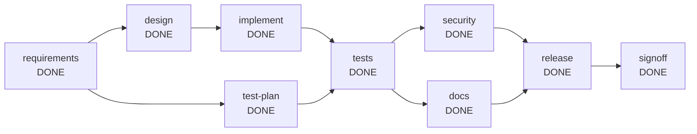

# Run report: failure-build

- Run id: `run-1ef3d2aa`
- Scenario: **GREENFIELD**
- Outcome: **COMPLETED**
- Requirement: Build a URL shortener service that creates short links, redirects visitors to the original URL and reports click statistics.
- Audit chain: verified (118 events)

## Reliability metrics

| Metric | Value |
| --- | --- |
| Nodes completed | 9 / 9 |
| First-attempt success rate | 89% |
| Retries | 2 |
| Rollbacks | 3 |
| Fallbacks | 1 |
| Safe-stops | 0 |
| Re-plans | 0 |
| Human approvals | 3 |
| Mean time to recovery | 684 ms |
| End-to-end latency | 1242 ms |

## Dependency graph

## Nodes

| Node | Agent | Risk | State | Attempts | Depends on |
| --- | --- | --- | --- | --- | --- |
| requirements | requirements | LOW | DONE | 1 | [] |
| design | architect | HIGH | DONE | 1 | [requirements] |
| test-plan | test | LOW | DONE | 1 | [requirements] |
| implement | developer | MEDIUM | DONE | 4 | [design] |
| tests | test | MEDIUM | DONE | 1 | [implement, test-plan] |
| security | security | MEDIUM | DONE | 1 | [tests] |
| docs | docs | LOW | DONE | 1 | [tests] |
| release | release | HIGH | DONE | 1 | [security, docs] |
| signoff | reviewer | HIGH | DONE | 1 | [release] |

## Timeline (state changes omitted)

| # | Type | Node | Actor | Detail |
| --- | --- | --- | --- | --- |
| 1 | RUN_STARTED | run | orchestrator | GREENFIELD \| Build a URL shortener service that creates short links, redirects visitors to the original URL and reports click statistics. |
| 2 | PLAN_CREATED | run | orchestrator | requirements; design<-[requirements]; test-plan<-[requirements]; implement<-[design]; tests<-[implement, test-plan]; security<-[tests]; docs<-[tests]; release<-[security, docs]; si... |
| 3 | CHECKPOINT | run | orchestrator | run-start -> 005be2f58633ec0292bb3fc34ceb1f91640539d2 |
| 6 | GATE | requirements | orchestrator | entry gate 'none': passed |
| 7 | AGENT | requirements | requirements | attempt 1: normalised requirement into 4 functional requirements and 4 acceptance criteria |
| 8 | GATE | requirements | orchestrator | exit gate 'outputs-exist:docs/requirements.md': passed |
| 10 | DECISION | requirements | requirements | D-1 completed: kept scope to what the requirement states; recorded 4 assumptions explicitly instead of guessing silently |
| 11 | CHECKPOINT | run | orchestrator | after requirements -> a12cb9cedf5618898d47631ddddacf682f2228f2 |
| 15 | GATE | design | orchestrator | entry gate 'inputs-available:docs/requirements.md': passed |
| 16 | AGENT | design | architect | attempt 1: produced design.md and openapi.yaml (0 amendments) |
| 17 | GATE | design | orchestrator | exit gate 'outputs-exist:docs/design.md,openapi.yaml': passed |
| 18 | POLICY | design | orchestrator | REQUIRE_APPROVAL [change-control] node 'design' is HIGH risk (Design the solution and the OpenAPI contract) |
| 20 | APPROVAL_REQUESTED | design | orchestrator | design: produced design.md and openapi.yaml (0 amendments) (node 'design' is HIGH risk (Design the solution and the OpenAPI contract)) |
| 21 | APPROVAL_DECIDED | design | human:simulated-reviewer | approved reviewed and approved (simulated) |
| 23 | DECISION | design | architect | D-2 completed: contract-first: the OpenAPI file is the reviewed artefact that the implementation must follow |
| 24 | DECISION | design | human:simulated-reviewer | D-3 approved: reviewed and approved (simulated) |
| 26 | GATE | test-plan | orchestrator | entry gate 'none': passed |
| 27 | AGENT | test-plan | test | attempt 1: test plan with 6 risk-based cases |
| 28 | GATE | test-plan | orchestrator | exit gate 'outputs-exist:docs/test-plan.md': passed |
| 29 | CHECKPOINT | run | orchestrator | after design -> 8cfeb00e586c346dc44752a8956cbb9321d5721e |
| 32 | GATE | implement | orchestrator | entry gate 'inputs-available:docs/design.md,openapi.yaml': passed |
| 34 | DECISION | test-plan | test | D-4 completed: tests are planned from the requirement in parallel with the design, so they are not biased by the implementation |
| 35 | AGENT | implement | developer | attempt 1: developer (greenfield): replayed the verified implementation (18 files); no language model configured [fault injected: BUILD_FAILURE] |
| 36 | GATE | implement | orchestrator | exit gate 'build-passes': FAILED - build failed: java/com/agentic/shortener/GeneratedDefect.java:3: error: incompatible types: String cannot be converted to int |
| 37 | AGENT | implement | developer | attempt 1 FAILED: gate 'build-passes' failed: build failed: java/com/agentic/shortener/GeneratedDefect.java:3: error: incompatible types: String cannot be converted to int |
| 39 | ROLLBACK | implement | orchestrator | undid the file changes of attempt 1 |
| 40 | CHECKPOINT | run | orchestrator | after test-plan -> 55cd4246c1c8c001656e3817515cdb25f601088b |
| 42 | RETRY | implement | orchestrator | retry 2/3 of developer after 200 ms |
| 45 | AGENT | implement | developer | attempt 2: developer (greenfield): replayed the verified implementation (18 files); no language model configured [fault injected: BUILD_FAILURE] |
| 46 | GATE | implement | orchestrator | exit gate 'build-passes': FAILED - build failed: java/com/agentic/shortener/GeneratedDefect.java:3: error: incompatible types: String cannot be converted to int |
| 47 | AGENT | implement | developer | attempt 2 FAILED: gate 'build-passes' failed: build failed: java/com/agentic/shortener/GeneratedDefect.java:3: error: incompatible types: String cannot be converted to int |
| 49 | ROLLBACK | implement | orchestrator | undid the file changes of attempt 2 |
| 51 | RETRY | implement | orchestrator | retry 3/3 of developer after 400 ms |
| 54 | AGENT | implement | developer | attempt 3: developer (greenfield): replayed the verified implementation (18 files); no language model configured [fault injected: BUILD_FAILURE] |
| 55 | GATE | implement | orchestrator | exit gate 'build-passes': FAILED - build failed: java/com/agentic/shortener/GeneratedDefect.java:3: error: incompatible types: String cannot be converted to int |
| 56 | AGENT | implement | developer | attempt 3 FAILED: gate 'build-passes' failed: build failed: java/com/agentic/shortener/GeneratedDefect.java:3: error: incompatible types: String cannot be converted to int |
| 58 | ROLLBACK | implement | orchestrator | undid the file changes of attempt 3 |
| 60 | FALLBACK | implement | orchestrator | primary agent exhausted its 3 attempts; switching to 'golden-developer' |
| 63 | AGENT | implement | golden-developer | attempt 4: applied the verified 'greenfield' implementation (18 files) |
| 64 | GATE | implement | orchestrator | exit gate 'build-passes': passed |
| 66 | DECISION | implement | golden-developer (fallback) | D-5 completed: fallback to the known-good implementation after the primary agent could not satisfy the gates |
| 67 | CHECKPOINT | run | orchestrator | after implement -> 5a452083e88a0f0c809b5d5ccf05bb9bbca1967b |
| 70 | GATE | tests | orchestrator | entry gate 'none': passed |
| 71 | AGENT | tests | test | attempt 1: tests passed (20 tests, 0 failures, 0 errors); replayed 3 verified test files; no language model configured |
| 72 | GATE | tests | orchestrator | exit gate 'tests-pass': passed |
| 74 | DECISION | tests | test | D-6 completed: the result is recorded in the run context; the exit gate, not the agent, decides acceptance |
| 75 | CHECKPOINT | run | orchestrator | after tests -> 7dbef7582852cd8a889b6b021534daa097e19e0a |
| 80 | GATE | security | orchestrator | entry gate 'none': passed |
| 81 | GATE | docs | orchestrator | entry gate 'none': passed |
| 82 | AGENT | security | security | attempt 1: security review PASS (0 non-blocking findings, 21 files scanned) |
| 83 | GATE | security | orchestrator | exit gate 'outputs-exist:docs/security-review.md': passed |
| 85 | DECISION | security | security | D-7 completed: blocking findings fail the node; the agent cannot waive them |
| 86 | CHECKPOINT | run | orchestrator | after security -> b0714aa45a27e68e24197e332578e24638600f3e |
| 87 | AGENT | docs | docs | attempt 1: README and changelog generated from 5 parsed endpoints |
| 88 | GATE | docs | orchestrator | exit gate 'outputs-exist:README.md,docs/CHANGELOG.md': passed |
| 90 | DECISION | docs | docs | D-8 completed: documentation is derived from the code so it cannot drift from the implementation |
| 91 | CHECKPOINT | run | orchestrator | after docs -> a713f282d151e96c65f4924f34365337daba28a1 |
| 94 | GATE | release | orchestrator | entry gate 'none': passed |
| 95 | AGENT | release | release | attempt 1: release readiness checklist passed (5 checks) |
| 96 | GATE | release | orchestrator | exit gate 'outputs-exist:docs/release-notes.md': passed |
| 97 | POLICY | release | orchestrator | REQUIRE_APPROVAL [change-control] node 'release' is HIGH risk (Release readiness check and release notes) |
| 99 | APPROVAL_REQUESTED | release | orchestrator | release: release readiness checklist passed (5 checks) (node 'release' is HIGH risk (Release readiness check and release notes)) |
| 100 | APPROVAL_DECIDED | release | human:simulated-reviewer | approved reviewed and approved (simulated) |
| 102 | DECISION | release | release | D-9 completed: release is blocked unless every check passes; the human approves afterwards |
| 103 | DECISION | release | human:simulated-reviewer | D-10 approved: reviewed and approved (simulated) |
| 104 | CHECKPOINT | run | orchestrator | after release -> 4b426a98b048e485bcfa48ec568688a2e0b1ffd1 |
| 107 | GATE | signoff | orchestrator | entry gate 'none': passed |
| 108 | AGENT | signoff | reviewer | attempt 1: engineering summary written for human sign-off |
| 109 | GATE | signoff | orchestrator | exit gate 'decisions-recorded': passed |
| 110 | POLICY | signoff | orchestrator | REQUIRE_APPROVAL [change-control] node 'signoff' is HIGH risk (Engineering summary and final human sign-off) |
| 112 | APPROVAL_REQUESTED | signoff | orchestrator | signoff: engineering summary written for human sign-off (node 'signoff' is HIGH risk (Engineering summary and final human sign-off)) |
| 113 | APPROVAL_DECIDED | signoff | human:simulated-reviewer | approved reviewed and approved (simulated) |
| 115 | DECISION | signoff | reviewer | D-11 completed: the reviewer only summarises recorded facts; it does not approve its own work |
| 116 | DECISION | signoff | human:simulated-reviewer | D-12 approved: reviewed and approved (simulated) |
| 117 | CHECKPOINT | run | orchestrator | after signoff -> c1c5bc95a95c1a46daa682b1745ca645bbc7ca24 |
| 118 | RUN_FINISHED | run | orchestrator | COMPLETED nodes 9/9, retries 2, rollbacks 3, fallbacks 1, safe-stops 0, replans 0, approvals 3, 1242 ms |

## Decisions

| Id | Node | Actor | Decision | Rationale |
| --- | --- | --- | --- | --- |
| D-1 | requirements | requirements | completed | kept scope to what the requirement states; recorded 4 assumptions explicitly instead of guessing silently |
| D-2 | design | architect | completed | contract-first: the OpenAPI file is the reviewed artefact that the implementation must follow |
| D-3 | design | human:simulated-reviewer | approved | reviewed and approved (simulated) |
| D-4 | test-plan | test | completed | tests are planned from the requirement in parallel with the design, so they are not biased by the implementation |
| D-5 | implement | golden-developer (fallback) | completed | fallback to the known-good implementation after the primary agent could not satisfy the gates |
| D-6 | tests | test | completed | the result is recorded in the run context; the exit gate, not the agent, decides acceptance |
| D-7 | security | security | completed | blocking findings fail the node; the agent cannot waive them |
| D-8 | docs | docs | completed | documentation is derived from the code so it cannot drift from the implementation |
| D-9 | release | release | completed | release is blocked unless every check passes; the human approves afterwards |
| D-10 | release | human:simulated-reviewer | approved | reviewed and approved (simulated) |
| D-11 | signoff | reviewer | completed | the reviewer only summarises recorded facts; it does not approve its own work |
| D-12 | signoff | human:simulated-reviewer | approved | reviewed and approved (simulated) |

## Artefacts

| Path | Version | Producer | SHA-256 |
| --- | --- | --- | --- |
| README.md | 1 | docs | 0c6dd62c1f4c |
| docs/CHANGELOG.md | 1 | docs | 9a39a59ef8d9 |
| docs/design.md | 1 | design | 6c089dafa586 |
| docs/engineering-summary.md | 1 | signoff | 373be99e00b6 |
| docs/release-notes.md | 1 | release | ec40197f39cd |
| docs/requirements.md | 1 | requirements | 07ddd24182b7 |
| docs/security-review.md | 1 | security | 2e466ae47616 |
| docs/test-plan.md | 1 | test-plan | bf12b68911d9 |
| docs/test-report.md | 1 | tests | 68a515c9979f |
| openapi.yaml | 1 | design | 488e995a81b4 |
| pom.xml | 1 | implement | e2d162df4424 |
| src/main/java/com/agentic/shortener/UrlShortenerApplication.java | 1 | implement | 97f8f9e84477 |
| src/main/java/com/agentic/shortener/api/LinkController.java | 1 | implement | 05871d762310 |
| src/main/java/com/agentic/shortener/api/RedirectController.java | 1 | implement | 82931653c712 |
| src/main/java/com/agentic/shortener/dto/LinkDtos.java | 1 | implement | 0b81a5d06620 |
| src/main/java/com/agentic/shortener/error/AliasConflictException.java | 1 | implement | 904c87287cc1 |
| src/main/java/com/agentic/shortener/error/GlobalExceptionHandler.java | 1 | implement | e2d26f21678d |
| src/main/java/com/agentic/shortener/error/InvalidAliasException.java | 1 | implement | a99eb3e08c6a |
| src/main/java/com/agentic/shortener/error/InvalidUrlException.java | 1 | implement | a4c5e8f00e23 |
| src/main/java/com/agentic/shortener/error/LinkNotFoundException.java | 1 | implement | 857cbb3e4e2d |
| src/main/java/com/agentic/shortener/model/Click.java | 1 | implement | a107581d7d82 |
| src/main/java/com/agentic/shortener/model/Link.java | 1 | implement | aab58ad58ceb |
| src/main/java/com/agentic/shortener/repository/ClickRepository.java | 1 | implement | 457ff4fb9254 |
| src/main/java/com/agentic/shortener/repository/LinkRepository.java | 1 | implement | 556df6d72bff |
| src/main/java/com/agentic/shortener/service/CodeGenerator.java | 1 | implement | 5094eab074d9 |
| src/main/java/com/agentic/shortener/service/LinkService.java | 1 | implement | b8859e342964 |
| src/main/java/com/agentic/shortener/validation/UrlValidator.java | 1 | implement | 3c14323b486e |
| src/main/resources/application.properties | 1 | implement | 112e1a466f05 |
| src/test/java/com/agentic/shortener/api/LinkApiTest.java | 1 | tests | 1c6889128a73 |
| src/test/java/com/agentic/shortener/service/CodeGeneratorTest.java | 1 | tests | e73a4bd617be |
| src/test/java/com/agentic/shortener/validation/UrlValidatorTest.java | 1 | tests | 283c1580a903 |
