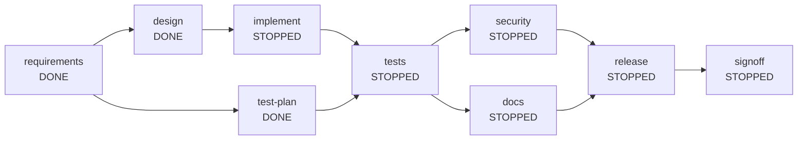

# Run report: failure-secret

- Run id: `run-2d5ae3ae`
- Scenario: **GREENFIELD**
- Outcome: **STOPPED** (fatal failure in 'implement': policy no-secrets: possible AWS access key id in 'src/main/resources/application-local.properties' written by agent 'developer')
- Requirement: Build a URL shortener service that creates short links, redirects visitors to the original URL and reports click statistics.
- Audit chain: verified (45 events)

## Reliability metrics

| Metric | Value |
| --- | --- |
| Nodes completed | 3 / 9 |
| First-attempt success rate | 100% |
| Retries | 0 |
| Rollbacks | 1 |
| Fallbacks | 0 |
| Safe-stops | 1 |
| Re-plans | 0 |
| Human approvals | 1 |
| Mean time to recovery | 0 ms |
| End-to-end latency | 286 ms |

## Dependency graph

## Nodes

| Node | Agent | Risk | State | Attempts | Depends on |
| --- | --- | --- | --- | --- | --- |
| requirements | requirements | LOW | DONE | 1 | [] |
| design | architect | HIGH | DONE | 1 | [requirements] |
| test-plan | test | LOW | DONE | 1 | [requirements] |
| implement | developer | MEDIUM | STOPPED | 1 | [design] |
| tests | test | MEDIUM | STOPPED | 0 | [implement, test-plan] |
| security | security | MEDIUM | STOPPED | 0 | [tests] |
| docs | docs | LOW | STOPPED | 0 | [tests] |
| release | release | HIGH | STOPPED | 0 | [security, docs] |
| signoff | reviewer | HIGH | STOPPED | 0 | [release] |

## Timeline (state changes omitted)

| # | Type | Node | Actor | Detail |
| --- | --- | --- | --- | --- |
| 1 | RUN_STARTED | run | orchestrator | GREENFIELD \| Build a URL shortener service that creates short links, redirects visitors to the original URL and reports click statistics. |
| 2 | PLAN_CREATED | run | orchestrator | requirements; design<-[requirements]; test-plan<-[requirements]; implement<-[design]; tests<-[implement, test-plan]; security<-[tests]; docs<-[tests]; release<-[security, docs]; si... |
| 3 | CHECKPOINT | run | orchestrator | run-start -> 005be2f58633ec0292bb3fc34ceb1f91640539d2 |
| 6 | GATE | requirements | orchestrator | entry gate 'none': passed |
| 7 | AGENT | requirements | requirements | attempt 1: normalised requirement into 4 functional requirements and 4 acceptance criteria |
| 8 | GATE | requirements | orchestrator | exit gate 'outputs-exist:docs/requirements.md': passed |
| 10 | DECISION | requirements | requirements | D-1 completed: kept scope to what the requirement states; recorded 4 assumptions explicitly instead of guessing silently |
| 11 | CHECKPOINT | run | orchestrator | after requirements -> a12cb9cedf5618898d47631ddddacf682f2228f2 |
| 14 | GATE | design | orchestrator | entry gate 'inputs-available:docs/requirements.md': passed |
| 15 | AGENT | design | architect | attempt 1: produced design.md and openapi.yaml (0 amendments) |
| 16 | GATE | design | orchestrator | exit gate 'outputs-exist:docs/design.md,openapi.yaml': passed |
| 17 | POLICY | design | orchestrator | REQUIRE_APPROVAL [change-control] node 'design' is HIGH risk (Design the solution and the OpenAPI contract) |
| 19 | APPROVAL_REQUESTED | design | orchestrator | design: produced design.md and openapi.yaml (0 amendments) (node 'design' is HIGH risk (Design the solution and the OpenAPI contract)) |
| 20 | APPROVAL_DECIDED | design | human:simulated-reviewer | approved reviewed and approved (simulated) |
| 23 | DECISION | design | architect | D-2 completed: contract-first: the OpenAPI file is the reviewed artefact that the implementation must follow |
| 25 | GATE | test-plan | orchestrator | entry gate 'none': passed |
| 26 | AGENT | test-plan | test | attempt 1: test plan with 6 risk-based cases |
| 27 | GATE | test-plan | orchestrator | exit gate 'outputs-exist:docs/test-plan.md': passed |
| 28 | DECISION | design | human:simulated-reviewer | D-3 approved: reviewed and approved (simulated) |
| 29 | CHECKPOINT | run | orchestrator | after design -> 79b9b47585477305593ad236f56e0345de4cf116 |
| 32 | GATE | implement | orchestrator | entry gate 'inputs-available:docs/design.md,openapi.yaml': passed |
| 34 | DECISION | test-plan | test | D-4 completed: tests are planned from the requirement in parallel with the design, so they are not biased by the implementation |
| 35 | POLICY | implement | orchestrator | DENY [no-secrets] possible AWS access key id in 'src/main/resources/application-local.properties' written by agent 'developer' (fatal) |
| 36 | CHECKPOINT | run | orchestrator | after test-plan -> 977c60812452cb186db011f0bdd61f8ec2962066 |
| 37 | SAFE_STOP | run | orchestrator | fatal failure in 'implement': policy no-secrets: possible AWS access key id in 'src/main/resources/application-local.properties' written by agent 'developer' |
| 44 | ROLLBACK | run | orchestrator | workspace restored to checkpoint 977c60812452cb186db011f0bdd61f8ec2962066 |
| 45 | RUN_FINISHED | run | orchestrator | STOPPED nodes 3/9, retries 0, rollbacks 1, fallbacks 0, safe-stops 1, replans 0, approvals 1, 286 ms |

## Decisions

| Id | Node | Actor | Decision | Rationale |
| --- | --- | --- | --- | --- |
| D-1 | requirements | requirements | completed | kept scope to what the requirement states; recorded 4 assumptions explicitly instead of guessing silently |
| D-2 | design | architect | completed | contract-first: the OpenAPI file is the reviewed artefact that the implementation must follow |
| D-3 | design | human:simulated-reviewer | approved | reviewed and approved (simulated) |
| D-4 | test-plan | test | completed | tests are planned from the requirement in parallel with the design, so they are not biased by the implementation |

## Artefacts

| Path | Version | Producer | SHA-256 |
| --- | --- | --- | --- |
| docs/design.md | 1 | design | 6c089dafa586 |
| docs/requirements.md | 1 | requirements | 07ddd24182b7 |
| docs/test-plan.md | 1 | test-plan | bf12b68911d9 |
| openapi.yaml | 1 | design | 488e995a81b4 |

_6 node(s) were STOPPED by the safe-stop; the workspace was restored to the last checkpoint._
