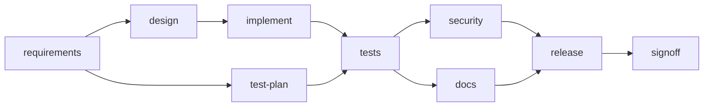

# Scenario 1 - Greenfield

**Requirement.** *Build a URL shortener service that creates short links, redirects visitors to the original URL and reports click statistics.*

**Starting point.** An empty working folder.

**Run it.** `./scripts/run-scenarios.sh greenfield` (or `POST /runs {"scenario":"GREENFIELD"}`)

## Decomposition

| Node | Agent | Risk | Entry gate | Exit gate | Produces |
|---|---|---|---|---|---|
| requirements | requirements | LOW | - | `docs/requirements.md` exists | requirements, acceptance criteria, **explicit assumptions** (302 vs 301, code length, storage) |
| design | architect | **HIGH** (human approves) | requirements artefact registered | `docs/design.md` + `openapi.yaml` | components, data model, decisions and trade-offs, risks, OpenAPI contract |
| test-plan | test | LOW | - | `docs/test-plan.md` | risk-based cases, **in parallel with the design** |
| implement | developer (fallback: golden-developer) | MEDIUM | design + contract registered | **project compiles** | the service |
| tests | test | MEDIUM | - | **tests pass** | JUnit tests, `docs/test-report.md` |
| security | security | MEDIUM | - | review exists, no HIGH finding | secret scan, dependency allow-list, SSRF guard check |
| docs | docs | LOW | - | README + changelog | **derived from the parsed code**, not from the plan |
| release | release | **HIGH** | - | release notes | readiness checklist, rollback plan |
| signoff | reviewer | **HIGH** | - | **a decision record exists for every other node** | engineering summary for the human |

`design ∥ test-plan` and `security ∥ docs` run in parallel; `tests` and `release` are joins.

## Orchestration highlights

* Three human checkpoints (design, release, sign-off). With `autoApprove` a simulated reviewer answers; over REST a person does.
* Every accepted node leaves a decision record with input and output artefact hashes and a git checkpoint.

## Validation

* Build gate and test gate run **real Maven** in the working folder (the sample evidence in `docs/sample-runs/` used a stand-in, see its README).
* The audit chain verifies; `report.md` lists metrics, graph, timeline, decisions, artefacts.

## Sample result (stand-in build)

9/9 nodes done, 100 % first-attempt success, 0 retries, 3 approvals - see [`docs/sample-runs/greenfield/report.md`](../docs/sample-runs/greenfield/report.md).
