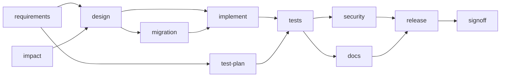

# Scenario 2 - Brownfield

**Requirement.** *Add optional link expiry and per-IP rate limiting to the existing URL shortener without breaking its current API.*

**Starting point.** The working folder is seeded with the reference shortener (code **and** its tests).

**Run it.** `./scripts/run-scenarios.sh brownfield`

## Decomposition and run-time changes

1. **Impact analysis (`impact`).** JavaParser reads the existing code: 17 classes, 5 endpoints, 2 entities. The requirement is mapped to *impacted components* (`Link` gains `expires_at`, `LinkService` must enforce expiry, `GlobalExceptionHandler` must map 410, a servlet filter protects all endpoints, ...) and classified: **schema change: yes, API change: yes**. Output: `docs/impact-analysis.md`.
2. **The plan grows.** Because a schema change was found, the planner **adds a `migration` node** (HIGH risk, human approval) and makes `implement` depend on it. This is recorded as `PLAN_EXPANDED` in the audit log.
3. **Design** is HIGH risk: a human approves the changed contract (new optional field, 410, 429).
4. **Mid-run requirement change.** After `implement` is done a change arrives: *"document the Retry-After header on 429 responses in the API contract"*. The engine amends the requirement, marks `design` and **everything downstream** `STALE → PENDING`, re-runs them, and counts one re-plan. The design is re-approved because it changed.
5. **Implement** applies the change set; the exit gate builds the project. **Tests** run the *existing* tests plus the new ones; no regression is the acceptance criterion.
6. **Docs** regenerate the README and changelog from the code that now exists (expiry and rate limit appear because the parsed code contains them).

## Validation

* Existing tests kept in the workspace and run by the test gate (regression safety).
* Migration and contract changes go through change control (human approval).
* `docs/CHANGELOG.md` records `0.2.0` with "no breaking API changes".

## Sample result (stand-in build)

11/11 nodes done, 1 re-plan, 6 approvals (design and migration were approved twice because of the re-plan) - see [`docs/sample-runs/brownfield/report.md`](../docs/sample-runs/brownfield/report.md).
