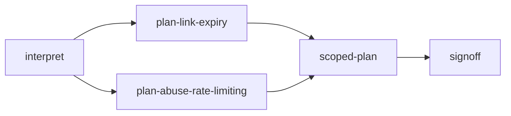

# Scenario 3 - Ambiguous requirement

**Requirement.** *Make links safer.*

**Starting point.** Nothing - and deliberately no code is produced until a human has narrowed the scope.

**Run it.** `./scripts/run-scenarios.sh ambiguous`, or over REST without `autoApprove` and answer the clarification yourself.

## Why this is the interesting one

"Safer" can mean blocking malicious destinations, limiting how long a link lives, limiting abuse, or restricting who can manage links. Each reading costs a different amount, touches a different part of the system and carries different risk. Picking one silently would be a guess presented as a result.

## Decomposition

1. **`interpret`** (requirements agent, human input). Writes `docs/interpretations.md`: four candidate interpretations, each with its meaning, the question to ask, a recommendation, and its risk. The node then **asks the human** (a *clarification* request) which are in scope.
2. **The plan grows.** For every interpretation the human confirmed, a `plan-<id>` node is added (parallel branches). In the sample run the human confirmed *link expiry* and *abuse rate limiting*; *malicious-URL blocking* and *authenticated management* were not confirmed, so **no node exists for them**.
3. **`scoped-plan`** (join) merges the plans into `docs/scoped-plan.md` with an explicit **in-scope** and **out-of-scope** list (the excluded items are named, with the reason "not confirmed by a human").
4. **`signoff`** (HIGH risk) - a human approves the scoped plan; the decisions-recorded gate requires a decision record for every node.

## Validation

* The confirmed scope becomes an assumption in the run context (`Scope confirmed by <actor>: [...]`) and a `scope-confirmed` decision record.
* A test asserts that **no source code** is produced in this scenario, and that unconfirmed interpretations get no node.

## Sample result

5/5 nodes done, 2 human interactions - see [`docs/sample-runs/ambiguous/report.md`](../docs/sample-runs/ambiguous/report.md).
